<p align="center">
  
</p>

<h1 align="center">Research Atlas</h1>

<p align="center">
  <a href="README.md">中文</a> · <strong>English</strong>
</p>

<p align="center">
  <strong>From Survey Papers to Technical Evolution Maps</strong><br>
  Have your AI coding agent read survey and primary papers, synthesize methods, technical taxonomies, and evidence-backed lineages,<br>
  and deliver a self-contained interactive HTML atlas for searching, filtering, and tracing technical pathways.
</p>

<p align="center">
  <a href="SKILL.md"></a>
  <a href="#local-build-and-validation"></a>
  <a href="examples/3dgs/README.md"></a>
  <a href="references/paper-extraction-schema.md"></a>
</p>

<p align="center">
  <a href="https://htmlpreview.github.io/?https://github.com/XuanwenZhou/research-atlas/blob/main/examples/3dgs/index.html"></a>
  <a href="#installation">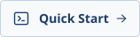</a>
  <a href="SKILL.md"></a>
</p>

<p align="center">
  <picture>
    <source media="(prefers-color-scheme: dark)" srcset="docs/images/readme-catalog-dark.png">
    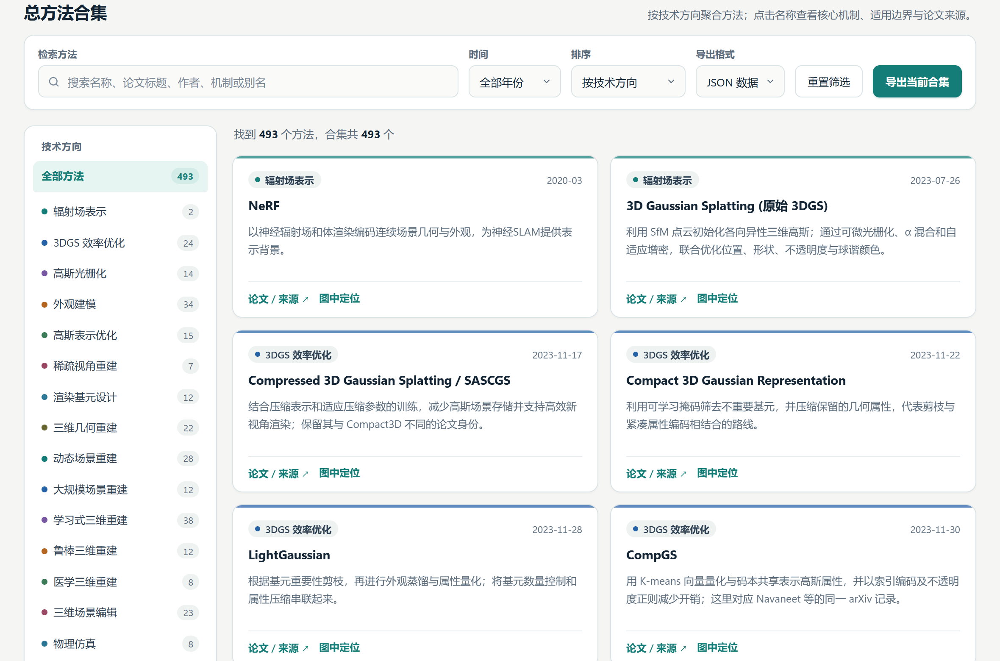
  </picture>
</p>

<p align="center">
  <picture><source media="(prefers-color-scheme: dark)" srcset="docs/images/readme-graph-dark.png">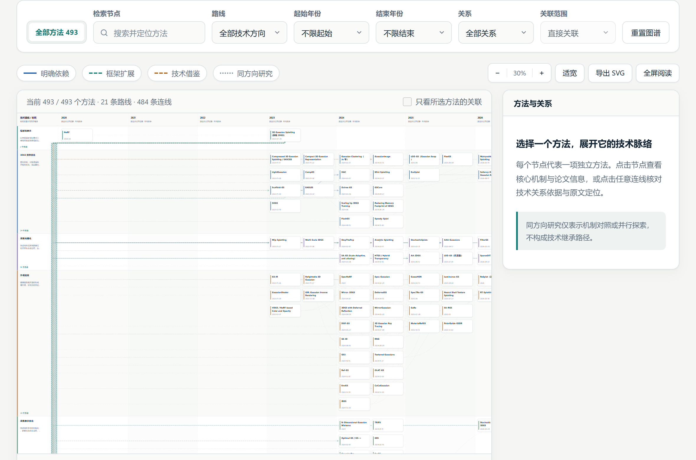</picture>
  <picture><source media="(prefers-color-scheme: dark)" srcset="docs/images/readme-evidence-dark.png">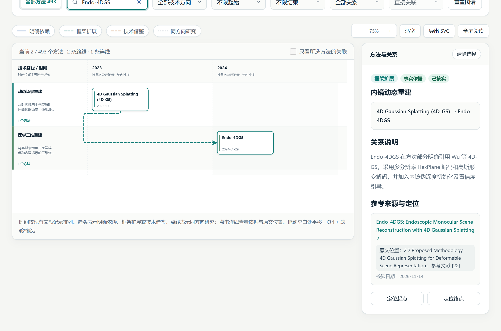</picture>
</p>

<p align="center"><sub>Screenshots above are captured from the bundled 3DGS showcase. Online preview uses GitHub HTML Preview, or download and open <code>examples/3dgs/index.html</code> offline.</sub></p>

<a name="why-research-atlas"></a>

## Why Research Atlas

When entering a new research field, reading several survey papers rarely produces a cohesive methodological map on its own: taxonomies are scattered across chapters, while inheritance, extension, and parallel lineages between foundational works and recent advances are easily buried in hundreds of citations.

Research Atlas turns literature review into a **traceable, evolvable structured research substrate** that supports three consecutive stages of scholarly work:

1. **Build a global mental model of the field**: Start from survey papers and extend along each technical branch with recent literature, mapping the landscape, core methodological trajectories, and citation-grounded inheritance or cross-pollination relationships among representative methods.
2. **Drill down into your own sub-topic**: Built on top of the full method catalog, refine and zoom into specific research problems without starting over—constructing a dedicated technical roadmap for your own thesis or paper while clarifying method boundaries and research gaps.
3. **Accumulate grounded context for AI-assisted writing**: The generated structured JSON and BibTeX preserve taxonomies, relation evidence, source locations, and bibliographic metadata. When drafting a Related Work section, comparing experimental baselines, or working with an AI agent, you can feed this verified substrate directly as context to reduce hallucinated citations and logical disconnects.

<a name="key-capabilities"></a>

##  Key Capabilities

| Capability | What You Get |
|---|---|
|  **Literature Extraction** | Trace primary papers from surveys, recording survey provenance, citation indices, and source locations; distinguish full-text reads, abstracts, and secondary summaries. |
|  **Method Catalog** | Deduplicate and normalize bibliographic metadata, separate papers from methods (supporting multiple methods per paper), and enable mechanism-level search and comparison. |
|  **Technical Taxonomy** | Group methods by research problem and core mechanism, preserving primary category, secondary tags, and classification rationale. |
|  **Evolution Analysis** | Distinguish direct inheritance, framework extension, mechanism borrowing, and thematic grouping; trace predecessor and successor pathways across recorded technical edges. |
|  **Literature Expansion** | Search follow-up studies along each taxonomy branch and technical trajectory, logging search scope and cutoff dates while preserving existing IDs during incremental updates. |
|  **Interactive Delivery** | Standalone HTML atlas, full JSON, taxonomy & relation files, CSV/BibTeX bibliographies, and a verification report; export graphs as SVG. |

<a name="installation"></a>

##  Installation

Clone the repository into your user-level skills directory so that `SKILL.md` sits at the root of that folder:

```bash
git clone https://github.com/XuanwenZhou/research-atlas.git ~/.agents/skills/research-evolution-map
```

On Windows, the user-level path is typically `%USERPROFILE%/.agents/skills/research-evolution-map`. You may also place it inside a project at `.agents/skills/research-evolution-map`. If an older copy exists under the same name, back it up or pull updates in place to avoid duplicate skills.

Invoke the skill explicitly in Codex by selecting **Research Atlas｜科研技术图谱** or typing `$research-evolution-map` (the directory and invocation name stay `research-evolution-map`; restart Codex if it does not appear). Because this repository follows the standard Agent Skills layout (`SKILL.md` + `references/` + `scripts/` + `assets/`), it is also directly compatible with Claude Code, Cursor, Antigravity, and other Agent Skills-enabled tools.

| Requirement | Purpose |
|---|---|
| Codex / compatible AI Agent with reading & web search tools | Read papers, analyze core mechanisms, taxonomies, and technical relations |
| Python 3.10+ | Schema validation, deduplication, HTML build, and exports (standard library only) |
| Modern browser | Open the generated standalone HTML offline with zero server or frontend dependencies |

<a name="usage-examples"></a>

##  Usage Examples

```text
Use $research-evolution-map for the research field [Field Name].
Read [survey files or URLs], cover the time range [Start Year–End Year],
synthesize the method catalog, technical taxonomy, and evolution relations,
expand with recent literature along each technical branch,
and generate the interactive HTML atlas, structured JSON, bibliography exports, and verification report.
```

You receive a self-contained **HTML atlas**, an incrementally updatable **project JSON**, **CSV/BibTeX bibliographies**, plus a retrieval verification report and an unverified-items checklist.

To incrementally update an existing project with newly collected papers:

```text
Use $research-evolution-map with our existing project JSON and this new batch of papers.
Add the new methods, taxonomy assignments, and evidence-backed relations while preserving all existing IDs,
then rebuild the HTML atlas and bibliography exports.
```

You can also take the generated project JSON as a starting point to drill down into a narrower sub-topic roadmap.

<a name="workflow"></a>

##  Workflow

<picture>
  <source media="(max-width: 600px) and (prefers-color-scheme: dark)" srcset="docs/brand/workflow-en-mobile-dark.svg">
  <source media="(max-width: 600px)" srcset="docs/brand/workflow-en-mobile-light.svg">
  <source media="(prefers-color-scheme: dark)" srcset="docs/brand/workflow-en-dark.svg">
  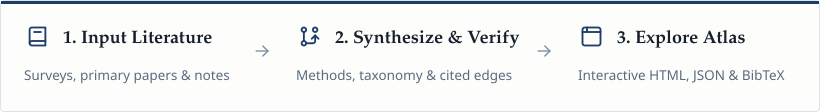
</picture>

Survey parsing, method extraction, deduplication, taxonomy synthesis, lineage analysis, branch-wise literature expansion, and HTML assembly execute end to end. Classification rationale, source provenance, fact vs. inference labels, and verification status are stored directly in the data, with open items summarized for review upon delivery.

<details>
<summary>See how structured data builds the atlas</summary>

The AI agent handles literature reading and technical judgment; Python scripts handle deterministic validation, HTML packaging, and bibliographic exports.

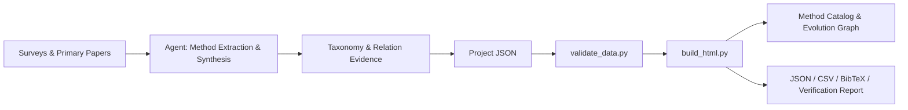

</details>

<a name="interactive-html-output"></a>

##  Interactive HTML Output

Using **3D Gaussian Splatting** as a real-world showcase, a single structured dataset powers both the Method Catalog and the Technical Evolution Graph:

<picture>
  <source media="(max-width: 600px) and (prefers-color-scheme: dark)" srcset="docs/brand/3dgs-stats-en-mobile-dark.svg">
  <source media="(max-width: 600px)" srcset="docs/brand/3dgs-stats-en-mobile-light.svg">
  <source media="(prefers-color-scheme: dark)" srcset="docs/brand/3dgs-stats-en-dark.svg">
  
</picture>

<br>

| View | Key Features |
|---|---|
| Method Catalog | Taxonomy sidebar, search by method/author/mechanism, year filter, sorting & pagination, paper/method detail drawer, and JSON/CSV/BibTeX export |
| Technical Evolution Graph | Displays all methods by default, timeline axis, start/end year range, four relation-type filters, predecessor/successor pathway tracing, node & edge evidence panels, focus highlighting, zoom/pan, fullscreen, and SVG export |

Both on initial load and after reset, the graph displays all included methods. Search and filters reveal local neighborhoods on demand; pathway tracing traverses technical edges (`direct`, `extension`, `borrow`) and excludes thematic (`theme`) links from inheritance paths.

[Walkthrough (ZH)](examples/3dgs/README.md) · [HTML File](examples/3dgs/index.html) · [Project JSON](examples/3dgs/project-data.json) · [Bibliography CSV](examples/3dgs/bibliography.csv) · [BibTeX](examples/3dgs/bibliography.bib)

GitHub displays raw HTML source when opening `.html` files directly; use the top **Live 3DGS Demo** button to preview online, or download `examples/3dgs/index.html` to browse offline. *(Note: the bundled 3DGS showcase dataset is authored in Chinese, while the skill and HTML template work for any research domain.)*

<details>
<summary><strong>Full Interactive Walkthrough</strong>: taxonomy, details, relation evidence, pathways, and export</summary>

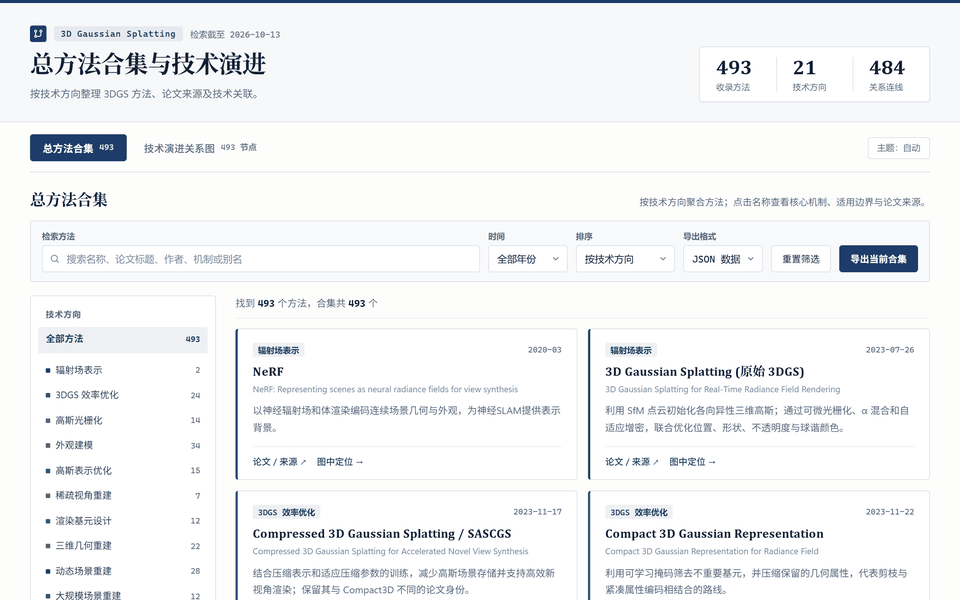

Suggested steps to explore the live demo:

1. In the Catalog view, select `稀疏视角重建` (*Sparse-View Reconstruction*) and year `2024` to inspect the 4 matching methods and export their citations.
2. In the Evolution Graph, search `Endo-4DGS` and click its edge from `4D-GS` to read the technical relation rationale and primary-paper evidence.
3. Search `Deformable Radial Kernel Splatting` and switch to **Predecessor Pathway** (`前驱技术路径`) to trace multi-hop predecessors along recorded technical edges.
4. Combine year range and relation-type filters, then reset to all methods and export the complete SVG.

</details>

<details>
<summary>Screenshots: method details, search neighborhood, and primary-source evidence</summary>

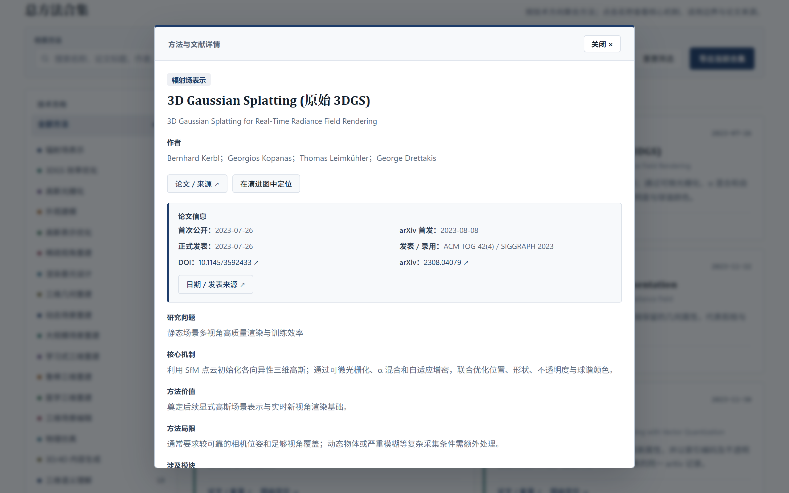

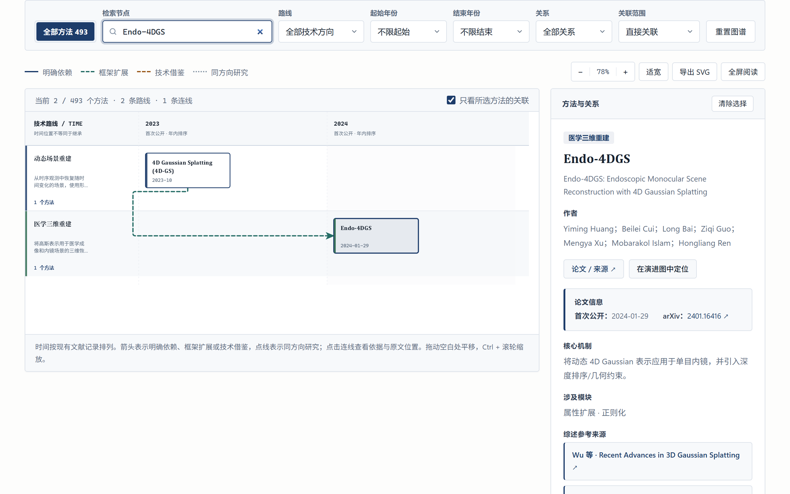

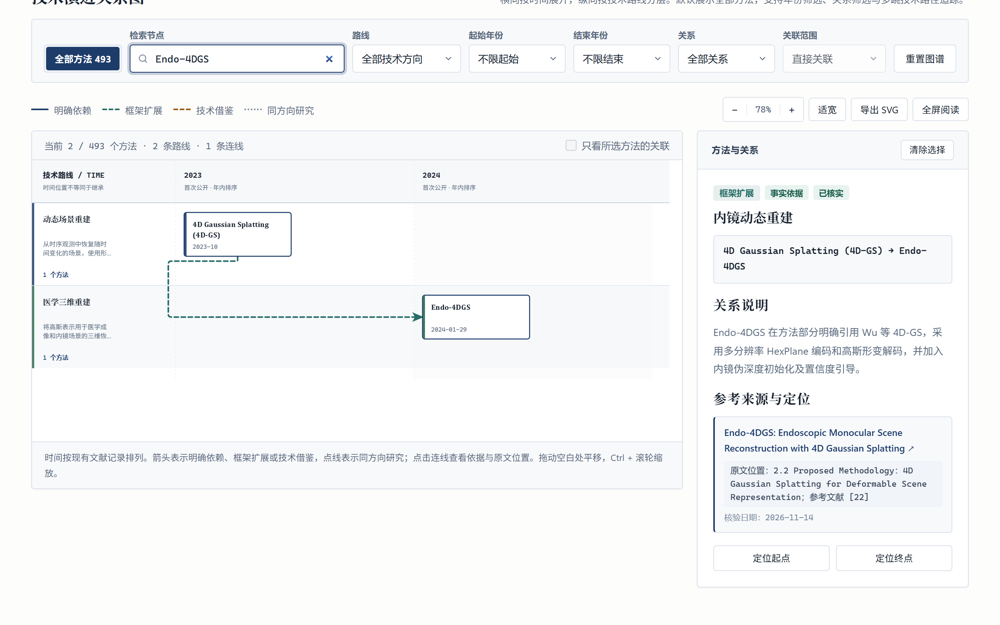

</details>

<details>
<summary>Screenshots: multi-hop pathways, year/relation filters, dark theme, and mobile layout</summary>

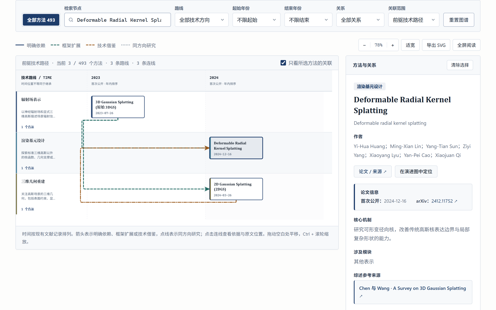

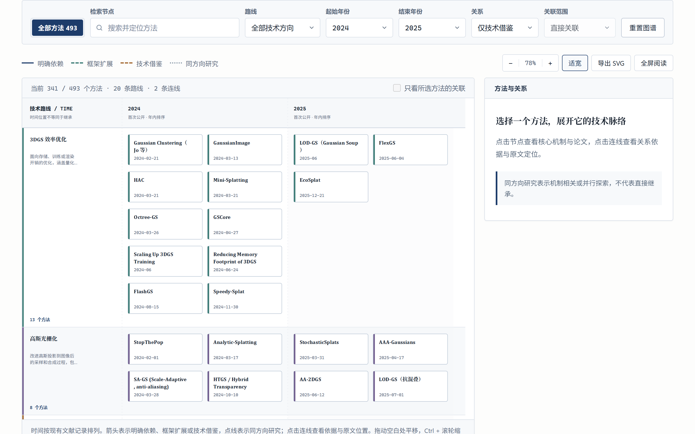

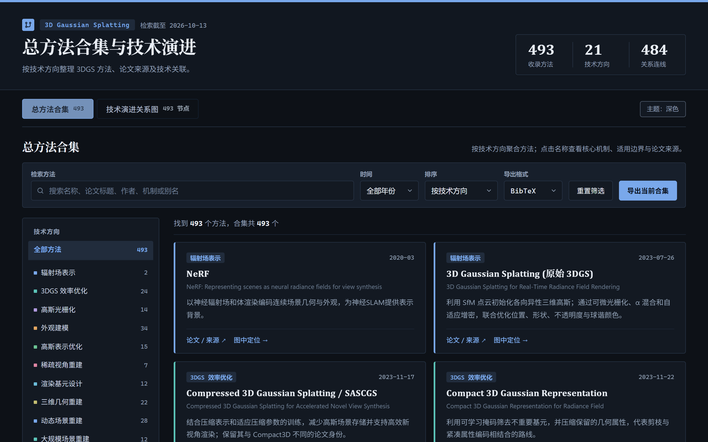

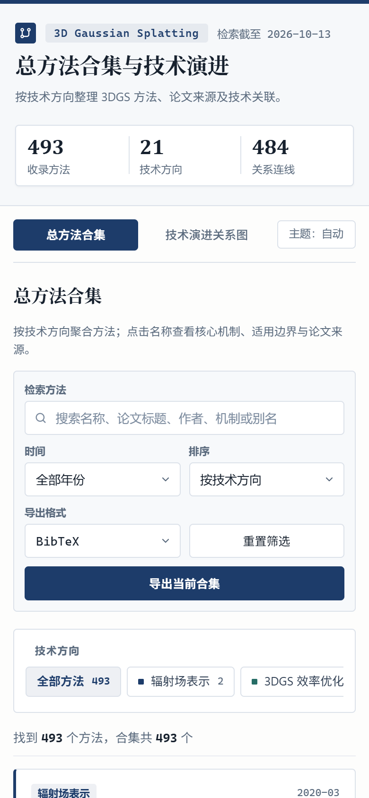

</details>

The bundled 3DGS showcase preserves real verification states and does not claim exhaustive coverage or complete verification of every citation. A compact synthetic dataset (`assets/example-data.json`) is also included for script and UI testing.

<a name="faq"></a>

## FAQ

<details>
<summary>Does the graph automatically prune down to a single main storyline?</summary>

No. All collected methods are displayed by default. Search, taxonomy track, year range, and relation-type filters let you focus on demand, and resetting restores the complete atlas.

</details>

<details>
<summary>Do all edges in the graph represent technical inheritance?</summary>

No. Only `direct`, `extension`, and `borrow` represent technical relationships; `theme` denotes parallel studies within the same direction. Clicking any edge displays its rationale and supporting evidence, with fact/inference labels and verification states preserved in the JSON.

</details>

<details>
<summary>Does the generated HTML require internet access or a frontend build toolchain?</summary>

No. Styles, scripts, and project data are embedded in a single standalone HTML file that opens offline in any modern browser. Internet access is only needed when opening external paper links or using the online GitHub HTML Preview.

</details>

<a name="local-build-and-validation"></a>

##  Local Build and Validation

<details>
<summary>Expand CLI commands, build outputs, and validation notes</summary>

Run from the repository root:

```bash
python scripts/self_test.py
python scripts/validate_data.py assets/example-data.json --report output/validation.json
python scripts/build_html.py assets/example-data.json --output output/evolution-map.html
```

Open `output/evolution-map.html` to inspect the synthetic example. Unverified warnings in the synthetic dataset are intentionally kept for testing; passing structural validation does not imply academic facts have been verified. Real projects should follow the [Data Contract](references/paper-extraction-schema.md).

Rebuild the real 3DGS showcase:

```bash
python scripts/build_html.py examples/3dgs/project-data.json --output output/3dgs/index.html
```

```bash
python scripts/deduplicate_papers.py project.json --report output/duplicates.json
python scripts/build_html.py project.json --output output/evolution-map.html
python scripts/export_bibliography.py project.json --output-dir output
```

Building produces the standalone HTML atlas, full JSON, taxonomy & relation JSONs, CSV/BibTeX bibliographies, validation/verification reports, and an unverified-items list. Pass `--strict` to treat unverified warnings as errors during final acceptance checks.

</details>

<a name="directory-structure"></a>

##  Directory Structure

<details>
<summary>View skill files and development resources</summary>

```text
research-atlas/
├── SKILL.md
├── README.md               # Chinese README (default)
├── README.en.md            # English README
├── agents/openai.yaml
├── assets/                 # Generic HTML template, synthetic example, and skill icons
├── references/             # Workflow, taxonomy, relation, and evidence specifications
├── scripts/                # Validation, deduplication, HTML build, export, and self-tests
├── examples/3dgs/          # 3DGS showcase HTML, JSON, CSV, and BibTeX built from the generic template
└── docs/                   # Real screenshots, README icons, and brand assets
```

Core execution rules live in [SKILL.md](SKILL.md). Aside from curated showcase examples, private literature libraries, full paper PDFs, and build/test outputs are excluded from the repository—store personal research projects in separate directories.

</details>

## Contributors

<table>
  <tr>
    <td align="center" width="50%">
      <a href="https://github.com/XuanwenZhou">
        <br>
        <strong>Coffee Cat</strong>
      </a><br>
      <sub>Project Lead · Product Design &amp; Content Review</sub>
    </td>
    <td align="center" width="50%">
      <a href="https://github.com/openai/codex">
        <br>
        <strong>Codex</strong>
      </a><br>
      <sub>AI-Assisted Engineering · Documentation &amp; Verification</sub>
    </td>
  </tr>
</table>

<p align="center">
  <a href="SKILL.md">Skill Specification</a> ·
  <a href="references/paper-extraction-schema.md">Data Schema</a> ·
  <a href="references/relationship-classification.md">Relation Criteria</a> ·
  <a href="docs/brand/THIRD_PARTY_NOTICES.md">Icon Notices</a>
</p>
