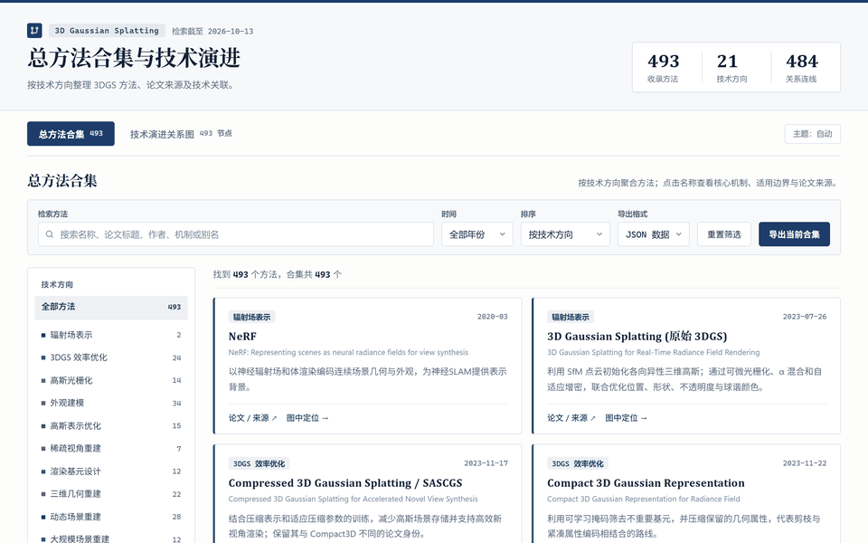
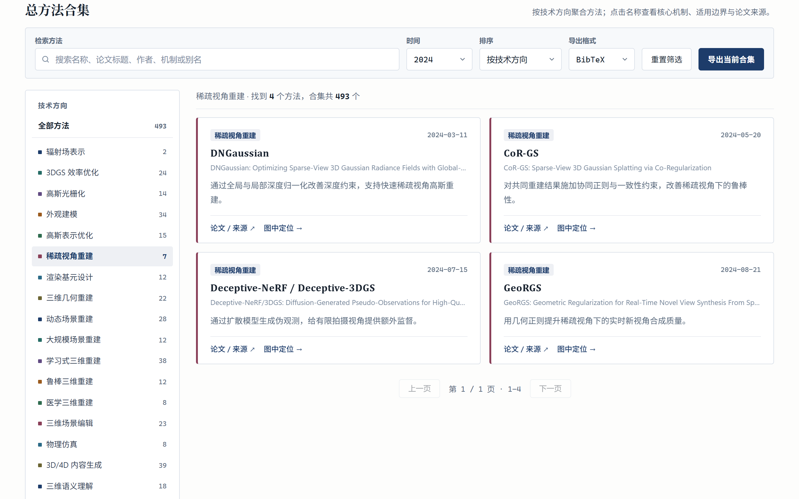
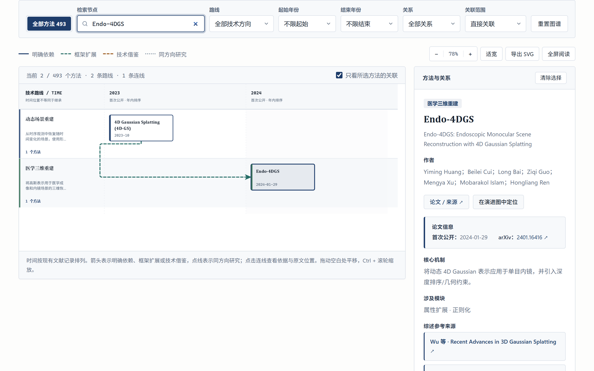
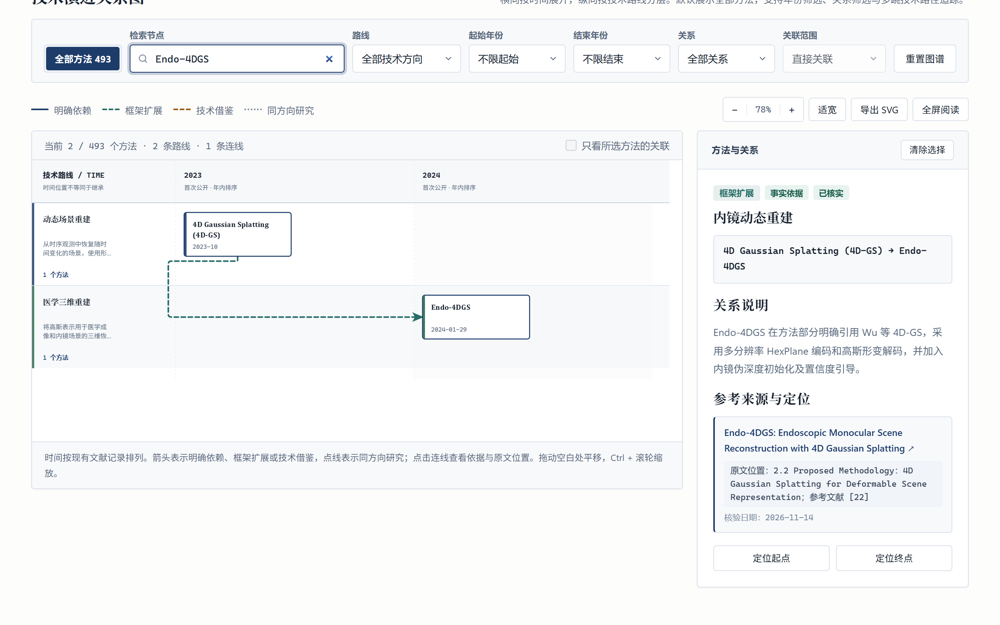
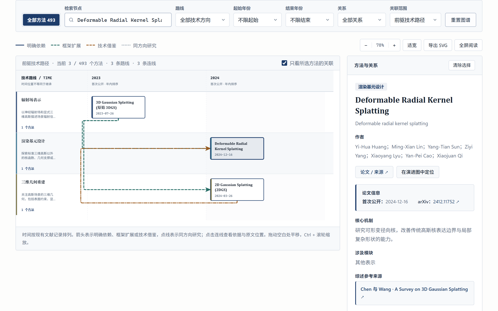
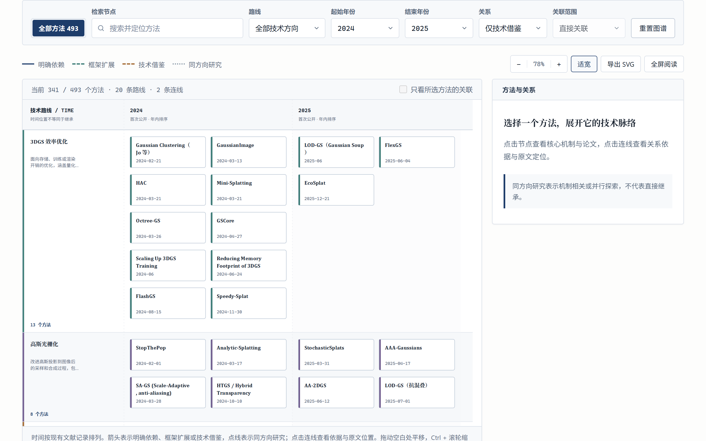
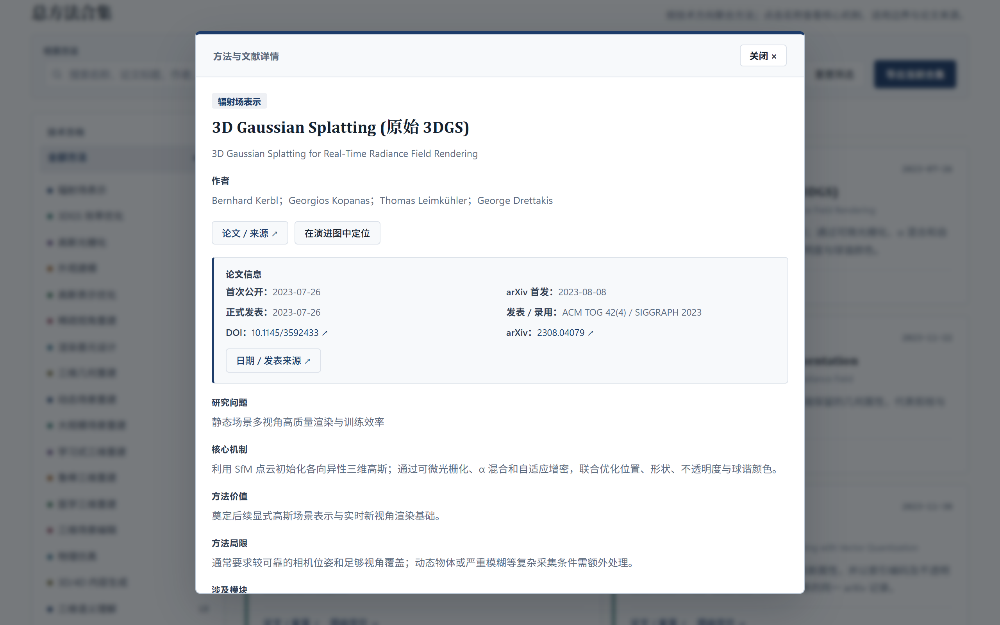
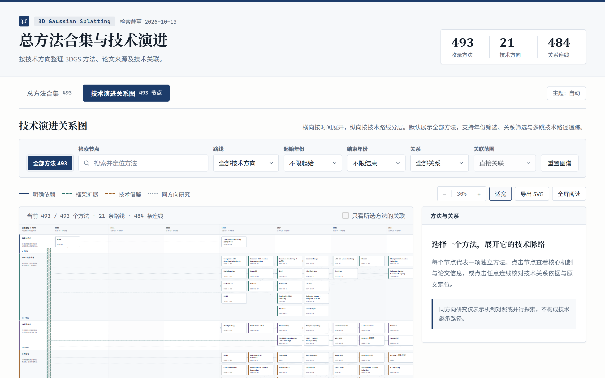
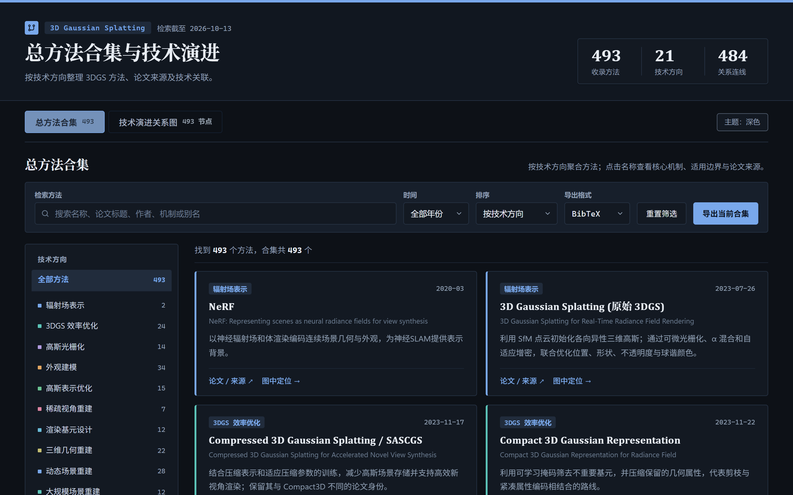
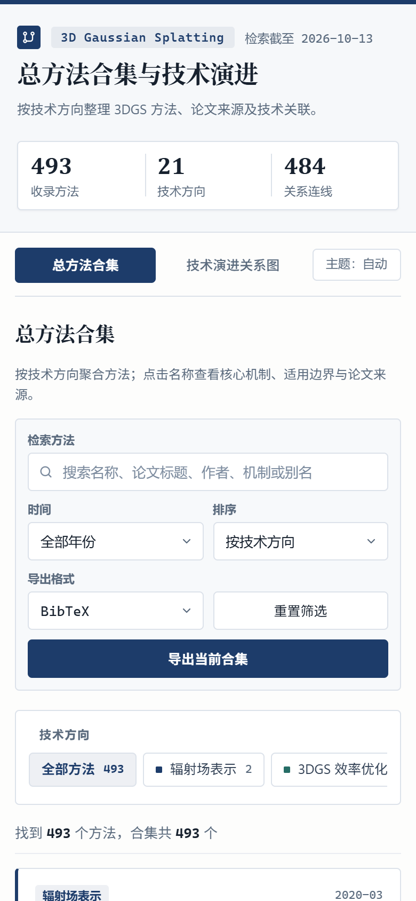

# 3DGS 方法合集与技术演进图

使用本仓库的通用模板展示既有 3D Gaussian Splatting 文献记录：**493 个方法、21 类技术方向、484 条技术关联、5 篇综述来源**。

- [在线体验](https://htmlpreview.github.io/?https://github.com/XuanwenZhou/research-atlas/blob/main/examples/3dgs/index.html)：使用 GitHub HTML Preview 加载本目录的 HTML，无需下载。
- [交互式 HTML](index.html)：下载后用浏览器打开，或克隆仓库后直接打开本文件夹中的 `index.html`。GitHub 文件页面只展示源码。
- [结构化数据](project-data.json)：可使用仓库脚本重新构建、校验和导出。
- [完整文献 CSV](bibliography.csv) · [完整 BibTeX](bibliography.bib)：与当前 JSON 对应，保留实际元数据。

下载仓库后直接打开本目录的 `index.html`，无需启动服务器或安装前端依赖。图谱首次打开和重置后均展示全部 **493 个方法、484 条关系**。下面的局部视图均由实际搜索或筛选产生。



## 可以体验的功能

| 功能 | 实际操作与结果 |
|---|---|
| 分类与文献检索 | 21类技术方向，名称、标题、作者、机制和别名搜索；支持年份、排序与24条分页 |
| 论文与方法详情 | 点击原始3DGS查看作者、首次公开与发表记录、DOI、核心机制、价值、局限及5篇去重后的综述来源 |
| 搜索定位与关联 | 搜索 `Endo-4DGS`，同时显示直接关联的 `4D-GS`，选中节点后高亮相邻连线 |
| 关系依据 | 点击二者的扩展连线，查看 HexPlane 与形变表示的说明、原文位置及论文入口 |
| 多级技术路径 | 选中方法后选择“前驱技术路径”“后续技术路径”或“上下游技术路径”，沿已有技术边展开并高亮整条路径 |
| 年份范围 | 起止年份与方向、关系类型组合筛选；区间倒置时同步调整另一端 |
| 四类关系 | 明确依赖11条、框架扩展52条、技术借鉴8条、同方向研究413条；可分别筛选 |
| 文献与数据导出 | 页面导出当前合集 JSON、文献 CSV 或 BibTeX；同一论文关联多个方法时按论文ID去重 |
| 图谱导出与浏览 | 导出当前图谱 SVG，支持拖动、Ctrl+滚轮缩放、适宽、全屏、明暗主题与移动端 |

技术路径只沿 `direct`、`extension` 和 `borrow` 边，遵守方向、年份及关系筛选；同方向研究不会参与继承路径。路径中的整理推断仍是推断，点击连线可查看依据。

## 操作示例

### 从分类中导出文献

在“总方法合集”中选择“稀疏视角重建”，再选年份“2024”，结果为4个方法。将“导出格式”切换为“文献 CSV”或“BibTeX”，点击“导出当前合集”。JSON 保留方法、分类和内部关系，CSV/BibTeX 面向文献条目。



### 从节点查看技术关系与依据

进入“技术演进关系图”，搜索 `Endo-4DGS`。页面保留它和直接关联方法；点击绿色连线，右侧显示关系说明与来源。继续点击方法名称或“定位起点／终点”可切换观察对象。





### 浏览多级前驱与指定年份

搜索 `Deformable Radial Kernel Splatting`，将“关联范围”切换为“前驱技术路径”，可查看库中3个相关节点和它们的技术边。也可以改为后续或上下游路径，或通过起止年份和关系类型进一步缩小范围。重置后恢复全部493个方法。





### 查看元数据、来源和不同屏幕下的显示

<details>
<summary>论文详情与综述引用</summary>



</details>

<details>
<summary>完整图谱、深色主题与手机宽度</summary>







</details>

## 数据范围

数据保留已有论文与方法 ID、常规技术分类、方法间关系、综述引用和日期来源记录。只有常规方法视图，`research_tracks` 为空；原始资料不随示例分发。

技术方向采用“辐射场表示”“高斯光栅化”“稀疏视角重建”“3DGS-SLAM”等任务或机制术语。[命名对照和文献依据](taxonomy-notes.md)记录全部21类的调整，分类ID和方法归属不变。

原记录截止日期为 **2026-10-13**。**2026-11-14** 对14个原缺日期且无连线的方法进行局部复核，依据 arXiv、CVF 论文集和作者机构记录补充日期及20条有来源的关系；原有464条关系保留。具体依据、位置及核验状态见 JSON，未对全库重新检索或逐篇核验。同方向连线不表示继承，部分方法价值仍为空。

GaussianImage 采用 arXiv v1 的 **2024-03-13**。HHAvatar 采用动态头发扩展 v3 的 **2024-11-20**，与早期 Gaussian Head Avatar 区分。两项仅有官方论文集月份证据的记录按 **2025-10** 放置，不推定具体日。`method-157` 和 `method-175` 很可能对应 GaussianMesh 的不同题名记录，以版本对照关联，保留稳定 ID，未自动合并。

通用结构还支持一文多法、二级分类、代表方法标记和专题配置。小型结构测试使用 [虚构示例数据](../../assets/example-data.json)；本页展示3DGS项目的实际配置。

## 重新构建与校验

在仓库根目录运行：

```bash
python scripts/validate_data.py examples/3dgs/project-data.json --report output/3dgs-validation.json
python scripts/build_html.py examples/3dgs/project-data.json --output output/3dgs/index.html
```

构建目录还会包含文献 CSV/BibTeX、分类与关系 JSON、核验报告和待核清单。页面的“导出当前合集”依据当前筛选结果；需要完整 SVG 时先重置图谱再导出。`output/` 为本地生成目录，不提交到仓库，仅本例经过检查的文献 CSV/BibTeX 随仓库提供。
